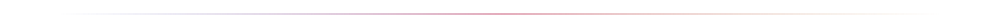
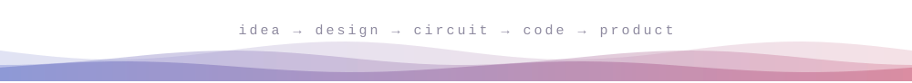

 

**I blend software, electronics and 3D design to build technically strong, genuinely useful products.**

 

<!-- Contact badges (uncomment and add your own links):

-->

## ✨ About me

I'm **HugeFiz**, a developer and **Industrial Design Engineering student**, working across **software, 3D CAD design, electronics and embedded systems**. Studying design engineering while shipping real products keeps me thinking about both how things work and how they feel to use.

I've been tinkering with **Arduino since 2018** and building **software and games since 2020**. As the founder of **Sorvia.net**, I ship plugins, scripts, web applications and automation tools. On the design side, I use **SolidWorks and AutoCAD** for 3D modeling, technical design and simulation.

## 🧠 What I do

 

## 🛤️ The journey

## 🚀 Selected projects

  
  
  
  

